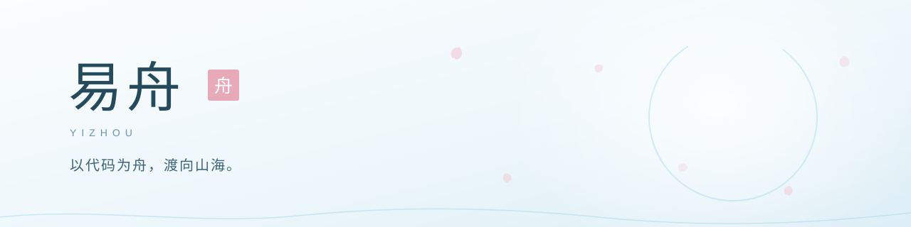

  <picture>
    <source media="(prefers-color-scheme: dark)" srcset="assets/banner-dark.svg">
    <source media="(prefers-color-scheme: light)" srcset="assets/banner-light.svg">
    
  </picture>

## 关于

我是易舟，正在学习 Java 与后端开发。喜欢把零散的想法整理成可以运行的东西，也在一点点补齐基础。

  <picture>
    <source media="(prefers-color-scheme: dark)" srcset="assets/stack-dark.svg">
    <source media="(prefers-color-scheme: light)" srcset="assets/stack-light.svg">
    
  </picture>

## 现在

愿每一次提交，都离山海更近一点。

